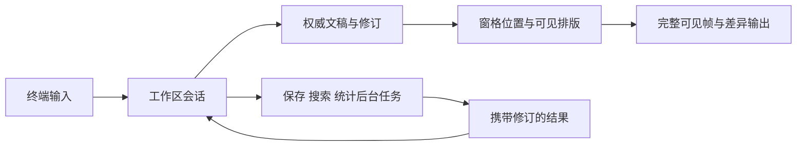

# 界面与终端兼容设计

本文件细化[设计规格](spec.md)。本文件描述界面方向与主要交互；兼容与性能目标仍需对应本地证据。

## 视觉风格与布局

视觉风格影响配色、边框和信息密度，布局影响窗格与面板的位置，两者分别配置。切换不重置文稿、选区、焦点或历史。阅读感为首次默认，三种风格都可选择并记忆。

| 风格 | 正文 | 辅助区域 | 降级 |
| --- | --- | --- | --- |
| 阅读感 | 居中、较多留白、柔和强调 | 弱边框和精简状态 | 基础色/反显仍能识别焦点 |
| 跟随终端 | 默认前景与背景 | 使用可用终端色板 | 不依赖成功查询主题颜色 |
| 紧凑工作台 | 更充分利用宽度 | 明确标题、边界与状态 | 保留正文最低可用空间 |

字体、字号、光标外观、透明度交给终端，默认背景也跟随终端。应用负责正文宽度、留白、主题、聚焦和对话高亮；不依赖特殊字体表达关键操作。

写作默认正文加状态行，章节、大纲、搜索按需打开。主动固定的模块再次启动时恢复。规划、校对可作为布局预设，不强制展开所有模块。独立随手记已移除。

```text
写作
  长夜行 · 第三章

                  雨落在窗沿上。

                  他把那封信重新展开……

  第三章  2,340 / 3,000 字              已保存   命令

双分屏与章节导航
  章节               第三章             第七章 [焦点]
  第一卷             雨落在窗沿上。     那封信终于有了回音。
    第三章
  第二卷
    第七章
  第七章  860 字                    保存中   切换窗格
```

线框只表达结构。布局按终端列宽计算，不能用字符串长度推断汉字、组合字符或 emoji 的位置。

## 响应式规则

阅读感的单窗格正文默认采用可用宽度的80%，上限92列；设置可选择更宽或铺满。辅助面板按预留正文空间决定是否展开，空间不足时优先正文。命令中心、设置和最近作品沿用正文横向轴线，在底部展开；宽窗最多8行、窄窗最多9行，搜索和分类切换时高度保持稳定。

双窗格每边正文区暂定至少 40 列或 10 个正文行。所选方向无法满足时临时显示活动窗格，保留隐藏窗格并提供切换命令。小于 40×12 时提示扩大窗口，同时保留保存、退出入口。计算必须扣除标题、状态和内边距。

缩放保留文稿锚点而非固定屏幕行号。临时隐藏与用户偏好分开；空间恢复可以恢复布局，但不能抢走焦点。首版提供命令调整左右位置、宽度和可见性，不做自由拖拽停靠。

## 焦点与双窗格

| 场景 | 行为 |
| --- | --- |
| 点击正文 | 激活对应窗格，定位到正确字素边界 |
| 拖选 | 改变该窗格选区，越界时有限速滚动 |
| 章节选择 | 在当前窗格打开；原有脏文稿继续由会话持有 |
| 同章双窗格 | 共用文稿与历史，各自保留位置 |
| 异章双窗格 | 分别编辑，手动保存/退出涵盖两边 |
| 交换窗格 | 对调文稿和视图位置，不复制正文 |
| 关闭窗格 | 保留文稿；不能丢弃尚未保存内容 |
| 弹层打开/关闭 | 保存来源焦点，关闭时恢复；来源消失则返回正文 |
| 模块关闭 | 注销事件，取消任务，将焦点移回可见目标 |
| 正常退出 | 完成全部保存并恢复终端；失败时保留会话 |

同章编辑通过修订映射更新另一窗格的光标和选区，不能将另一窗格直接跳到编辑位置。撤销当前章节的最近事务；反馈显示章节，避免误认为历史按窗格独立。

## 文件与启动

首次启动显示轻量开始页，只包含最近文件或作品、打开和新建作品入口；未选择实际路径时没有文稿，也不会生成临时作品。无参数可恢复上次单篇文件或作品章节；恢复失败保留原因和其他选择，不静默删除条目。

单篇文件与作品有明确的最近记录类型，保留光标并兼容已有作品记录。移除最近记录不删除手稿，当前会话后续保存也不会重新加入主动移除的条目。最近配置损坏或写入失败单独提示，不能把已经保存的正文标为保存失败。

来自 CLI、最近记录与打开输入的文件请求统一验证路径，解析主目录并规范化真实路径；作品内章节须经作品目录打开，避免绕开锁和共享元数据。内部章节读取保留自己的 Interface。路径 Tab 补全只扫描当前一级目录，限制扫描量与候选数量，不在渲染时读盘；普通目录仅用于继续补全，不会被自动创建或转换成作品。

## 输入与命令

核心命令包括作品打开/切换、卷章管理、跳章、查找替换、全书搜索、分屏、模块开关、排版、快照、恢复、保存与退出。所有命令有可搜索的文字入口和当前可用快捷键提示。

默认常规编辑：方向键、Shift 选区、Home/End、翻页、撤销重做。F1或Ctrl+P打开命令中心，也可点击底部命令入口；F4打开设置。命令查询与单行输入共享字素安全编辑和水平视口。快捷键实际是否被终端截获仍需本地验证。

Esc用于关闭当前工具区或取消操作，不作为正文命令前缀；正文中的斜杠正常输入。字符输入、粘贴、协议回复和控制事件分流，不强制修改用户的终端全局配置。

底部“正文／标题”入口直接提供设为标题、改回正文；修改当前逻辑行并可撤销，Markdown标记仍可见。标题识别在软换行之前完成，折行保持语义蓝色，代码围栏和普通标签不误着色。真实章节名匹配保持既有样式，入口明确导向目录章名修改，正文不自动替换。

中文候选与预编辑由系统/终端管理，应用插入已提交文本。候选确认、取消、组合字符和中文标点需要真实输入法验证，不能仅凭合成按键测试认定通过。

## 鼠标与剪贴板

点击、拖选、滚轮是主要体验，同时保留完整键盘路径。应用选区与终端历史选区分开说明；不能假定能读取终端自身选区。

本机系统剪贴板 Adapter 优先，终端剪贴板协议仅作可选补充。失败时明确告知，提供应用内复制粘贴；不能把旧内部内容假装成系统当前内容。分隔粘贴可用时作为完整事务，不可用时保留普通输入和终端原生粘贴入口，并说明整批撤销识别受限。

粘贴中的控制字符不执行终端命令。用于显示的安全替代符不应静默改写保存的普通正文；对不允许的输入字符采用明确、一致的文本处理规则并测试。

## 终端能力矩阵

能力分别检测，不只按终端名字判断。探测有超时，无回复使用保守值；提供覆盖选项和重置默认。

| 能力 | 支持时 | 不支持或失败时 |
| --- | --- | --- |
| 真彩色 | 完整主题 | 256 色、基础色或单色，保留文字与反显 |
| 增强按键 | 更准确区分修饰键和事件 | 基础键与命令入口 |
| 鼠标报告 | 点击、拖选、滚轮 | 键盘等价操作 |
| 系统剪贴板 | 与其他应用交换选区 | 内部剪贴板，说明系统操作失败 |
| 粘贴分隔 | 整批编辑事务 | 普通输入，终端原生粘贴路径 |
| 焦点事件 | 切回及时校验磁盘 | 低频检查加写入前校验 |
| 同步输出 | 减少中间帧 | 完整帧加缓冲区差异输出 |

基线需要 Unicode、基本光标定位、键盘输入和屏幕刷新。非交互重定向不进入全屏应用。正常退出、挂起恢复及可处理异常必须清理自己启用的模式；强制终止无法保证恢复，文档提供修复终端的方式。

## 专注写作

专注是临时显示状态，不能关闭或复制文稿。进入后仅绘制活动窗格，隐藏另一窗格及固定面板；退出恢复分栏方向、每个窗格的位置和仍有效的来源焦点。保存的分屏状态与当前可见分屏分别判断，正文按阅读宽度居中，不沿用隐藏双栏的尺寸。布局文件和独立的聚焦、对话、打字机偏好不被改写。

顶栏与窗格编号在专注时收起，底部只留字数、真实保存状态、退出专注和命令。窄屏优先保留保存失败、冲突或只读状态，必要时让字数让位；错误说明仍能显示。写作设置与命令中心都能进入，底部可点击退出。命令和设置继续在共享底部区域展开，关闭后回到原文稿位置。几何变化即时生效并清除旧命中与过渡历史，不给正文和光标做位移动画。

## 性能与保存反馈



无输入、任务结果或必要状态变化时休眠。后台检索和计数可取消，保存顺序受控；模块渲染不得做整书扫描或写盘。终端字符行滚动不是 GUI 像素级滚动，不依赖持续动画制造流畅感。

状态区分待保存、保存中、已保存、冲突和失败。旧修订写入完成后，如果还有新输入，仍显示未完成保存。双窗格存在未保存内容时工作区不能显示全局已保存。

## 本地兼容记录

macOS 的 kitty、Terminal.app、iTerm2、WezTerm、Ghostty，Windows 的 Windows Terminal、WezTerm，以及 Linux 常见现代终端是设计目标示例，不是已测试列表。复用器与 SSH 路径独立记录，不能由直接启动结果推断通过。

当前提供本地预览实现。自动化行为测试与真实终端验收分开；输入法、原生鼠标和剪贴板、最终视觉与屏幕响应必须在相应环境验证。仅在本机可用环境执行，未测平台和终端保持待验证。

每条本地记录应含系统、终端与版本、字体、窗口尺寸、输入法、能力、配置、步骤、结果和证据。架构覆盖范围与已验证范围分开维护。
