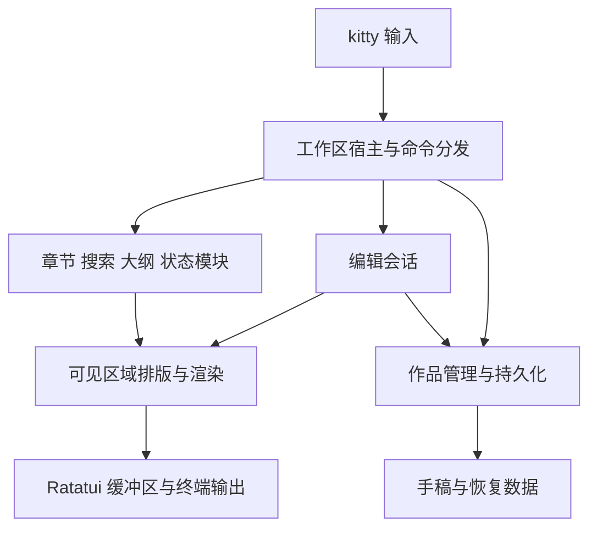

# Novelite TUI 产品与架构设计

设计日期：2026-10-17。状态：初稿；实现与性能验证待开展。

## 产品方向

在 macOS Apple Silicon 的 kitty 中长时间写中文小说。优先级依次为正文输入与数据正确性、响应流畅、界面质感、模块组合、功能广度。采用常规编辑器操作。沿用 Novelite 的写作概念和功能组织方式，以适合终端的方式重新实现界面。

独立仓库 `hirovel/novelite-tui`，独立二进制 `novelite-tui`。首版面向本机 kitty 会话。终端复用器和远程会话需要独立验证，不能由本机结果推断兼容。

## 界面与布局

使用安静的背景、清楚的正文、一个强调色和少量细分隔线。默认跟随终端底色，提供完整的深色和浅色主题。选中、焦点、保存异常同时用文字或形状区分。状态栏只保留当前章节、字数、保存状态及必要操作提示。

正文默认 80 个终端列宽，约 40 个全角汉字；宽度可配置。居中留白随窗口收缩。默认隐藏行号，软换行不改变文件内容。背景透明度、字体与字号交给 kitty。首版用终端字符栅格呈现，不依赖特殊字体或图像来表达关键操作。

### 三种工作布局

| 布局 | 默认内容 | 使用目的 |
| --- | --- | --- |
| 写作 | 居中正文、底部状态；章节导航按需打开 | 长时间输入 |
| 规划 | 左章节树、中正文、右章节大纲或随手记 | 组织情节、对照写作 |
| 校对 | 左搜索结果、中正文；需要时打开参考章节 | 查找、替换、检查上下文 |

这些是同一工作区的布局预设，切换布局保留光标、选区、滚动锚点和撤销历史。专注模式临时隐藏周边模块，再退出时恢复原布局。参考章节首版只读，避免双编辑视图分散核心编辑验证。

```text
Novelite · 长夜行                                     规划

第一卷                第三章 雨夜                 章节大纲
  第一章 归途                                      交代来信
  第二章 来客         雨落在窗沿上。               埋下伏笔
› 第三章 雨夜
                      他把那封信重新展开……
第二卷                                            随手记
  第四章 远行                                      核对时间线

第三章 · 2,340 字 / 3,000                    已保存 · 命令
```

### 响应式规则

布局按终端列数计算，不把汉字数量当作列数。首轮默认值：

- 140 列及以上允许三栏：导航 24 列，正文 80 列，辅助区 28 列，加留白与分隔。
- 110–139 列允许导航与正文；辅助区改为可关闭的覆盖面板。
- 60–109 列保留正文；导航、搜索和大纲以覆盖面板出现。
- 更小窗口显示紧凑视图；不足 40×12 时保留保存与退出入口并提示扩大窗口。

缩小时优先保护正文。自动收起面板不清空用户偏好，空间恢复后可恢复。弹层关闭后将焦点和滚动位置交还原模块。首版通过命令调整模块左右位置、宽度、可见性；暂缓自由拖拽停靠系统。

## 编辑交互

直接输入，无普通/插入模式切换。方向键、Shift 选区、Home/End、PageUp/PageDown、鼠标定位、拖选、滚轮、撤销重做为基础操作。软换行后的上下移动按视觉行，保留期望列；中文、emoji 和组合字符按字素边界编辑，屏幕坐标另按终端显示宽度计算。

命令面板是所有模块操作的统一入口，键位只映射到命令，不在每个面板另造一套行为。保存、查找、撤销以 Mac 常用组合键为目标，并提供 Ctrl 备用绑定及面板入口。实际默认键表在 kitty 冲突验证后确定。

kitty 会处理部分系统快捷键。应用选区和终端选区要明确区分；剪贴板使用本机能力，粘贴按完整文本批次进入编辑事务。提供应用专用的 kitty 启动配置方案，不直接覆盖用户全局配置。应用退出或异常时恢复 raw mode、鼠标报告、键盘增强协议及光标状态。

中文输入必须通过实际输入法测试：候选位置随真实终端光标、确认与取消不误触命令、提交文本不重复、组合阶段按键不生成错误编辑。IME 候选与预编辑由 macOS/kitty 管理，应用不假定自己能观测所有组合状态。禁止仅根据物理按键重新拼出正文。

“丝滑”以即时输入、稳定光标、无闪屏和连续滚动为准。首版采用字符行滚动，合并高频滚动事件并限制单次处理预算；不额外添加持续动画来制造流畅感。终端的字符栅格不能等同于 GUI 的像素级滚动。

## 继承与融入模块化界面

现有 Novelite 的扩展点包含命令、侧栏、右面板、状态项、导出和格式化。TUI 保留这些概念，统一成内置模块注册表；React 节点、CodeMirror 扩展和浏览器事件逻辑需要重新实现。

| 模块 | 可贡献的界面 | 首版行为 |
| --- | --- | --- |
| 章节 | 导航、命令、状态 | 卷章管理、快速跳转、排序 |
| 大纲与随手记 | 辅助面板、命令 | 跟随当前章节、随时收起 |
| 搜索 | 覆盖层或侧栏、命令 | 章节查找替换、全书结果跳转 |
| 字数与目标 | 状态项、辅助面板 | 增量计数、当前目标 |
| 历史与恢复 | 覆盖层、命令 | 预览快照、恢复前备份 |
| 导入导出 | 命令 | TXT/Markdown 和作品目录 |

Module 的 Interface 包含稳定 ID、贡献声明、命令处理和订阅生命周期。宿主统一负责焦点、布局、主题、快捷键冲突与刷新请求。模块向宿主返回动作或后台任务，不能在渲染中写盘、检索全书或阻塞等待。关闭模块撤销订阅并取消任务。

首版为编译进程序的内置模块。模块化界面不等于必须立即实现第三方插件运行时；先用章节和搜索两个真实模块验证 Interface，再决定是否扩展到动态插件。

## 技术组织

Rust + Ratatui + Crossterm 为推荐路线；长文本编辑控件采用门槛测试后选择。原桌面版的 TypeScript 类型与行为用作兼容参考，不引入 WebView 或 Node 运行时来托管旧界面。

初期在一个 Cargo 包内按以下模块组织，确有独立复用需求再拆 crate：



编辑模块的 Interface 围绕 `apply(edit)`、`undo/redo` 和 `view(viewport)` 组织，隐藏文本缓冲、字素坐标映射、布局缓存和历史。作品模块的 Interface 围绕打开、提交修订、恢复与关闭组织，隐藏写入队列、文件布局和恢复流程。窗口渲染通过快照读取状态，不获得随意修改保存层的能力。

同一章节一个权威文本缓冲和单调递增修订号。搜索、计数、保存结果携带修订号；过期搜索结果丢弃，保存完成只确认对应修订。关闭面板或跳转章节不会复制正文为新的权威状态。

## 流畅度实现原则

1. 输入事件优先处理，连续事件有时间预算，防止长粘贴或滚轮淹没其他事件。
2. 优先验证 Rope 类文本缓冲。维护可见段落与软换行缓存，编辑局部失效；窗口变化不能在输入线程同步重排整部小说。
3. Ratatui 每次绘制完整的可见帧，由缓冲区差异比较减少终端输出。不能误用“只更新变化”而漏画本帧仍需显示的模块。
4. 字数按编辑变化增量计算，全书检索可取消，文件读写和恢复快照在后台进行；任务完成回到宿主统一更新状态。
5. 单写入队列保证顺序，合并尚未启动的过期自动保存。后台保存成功不允许把更新的修订标成已保存。
6. 无输入、任务结果、布局变化或必要状态变化时休眠。光标闪烁尽量交给终端；不运行固定 60 FPS 空循环。
7. 大作品按需加载章节；缓存与撤销历史设置内存预算。达到预算不能静默抛弃未落盘内容。

## 保存与桌面互通

一部作品一个文件夹，UTF-8 TXT/Markdown 保存正文，`novelite.json` 保存 schema 版本、稳定 ID、文件映射、顺序和大纲。界面位置存在本机设置中。`.novelite/history/` 保存恢复数据。

自动保存拟定为输入停顿 300ms 后触发，持续输入时每 2s 安排一次后台保存；这些是可调起点，需实测。写入采用同目录临时文件、刷新和原子替换；目录元数据持久化和多文件结构变更需有恢复日志。保存反馈必须对应已完成的持久化修订。新建、排序、改名、删除采用可恢复的结构事务。

检测外部变化时对比已读取修订/内容指纹，出现冲突保留两份并交由用户选择，不自动覆盖。TUI 实例通过 OS 锁限制同时写入；该锁不能约束未遵守协议的编辑器或旧桌面客户端，因此仍需外部变更检查，且不承诺任意程序同时写同一文件的安全性。

首版通过旧桌面版现有目录/TXT 导出导入正文。旧版导出不会完整携带大纲和历史快照，导入说明必须显示这一点。完整元数据互通需要桌面版实现相同格式；未来共享核心是单独迁移计划。

强制终止能恢复到最后一次完成持久化的修订。未持久化的最后输入存在损失窗口，验收记录该窗口，不能声称绝对零丢字。

## 独立发布

本仓库维护自己的版本、Release、校验和与 Homebrew Formula。正式包为 macOS arm64，面向本机 kitty。Formula 分发路径待首个发行包确定后公布，不能提前展示不可安装命令。

更新由 Homebrew 执行；运行中的编辑会话不自替换二进制。下次启动使用新版，数据格式迁移前备份，未知的新 schema 拒绝写入并说明所需版本。独立仓库的 Release 不会占用桌面仓库的 latest 更新入口。

## 实现顺序

1. 编辑验证：中文输入、软换行、鼠标选区、撤销、窗口变化和 10 万字章节性能。控件通过后锁定依赖版本。
2. 工作区：主题、三种布局、焦点管理、命令面板，以及章节/搜索两个模块，验证模块 Interface。
3. 作品：目录格式、保存与恢复、外部变更、导入导出，打通真实写作闭环。
4. 发布：真实 Mac kitty 验收、性能报告、Homebrew 安装和升级测试。

每一阶段按 [验收标准](acceptance.md) 留证据。参考项目与具体取舍见 [参考记录](references.md)。
